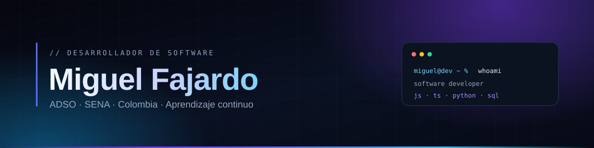

  

<h1 align="center">Miguel Fajardo</h1>

  <strong>Desarrollador de software junior</strong> · Estudiante de ADSO en el SENA

  Me interesa el desarrollo web, la programación y las bases de datos. 
  Aprendo construyendo proyectos y cuidando los detalles.

  
  

<h2 align="center">🧭 Sobre mí</h2>

Soy **Miguel Ángel Fajardo Zapata**, desarrollador de software junior y estudiante de
**Análisis y Desarrollo de Software (ADSO)** en el SENA. Mi formación me ha dado bases en
programación, desarrollo web y bases de datos, y las pongo en práctica con proyectos propios.

- 🎓 **Formación:** ADSO en el SENA (en curso) y Técnico en Programación de Software.
- 🧩 **Enfoque:** aplicaciones web, lógica de programación y bases de datos.
- 💡 **Cómo trabajo:** entiendo el contexto, divido el problema y busco una solución clara.
- 📚 **Ahora mismo:** reforzando fundamentos y publicando proyectos reales.

<h2 align="center">⚙️ Stack &amp; Herramientas</h2>

<table>
  <tr>
    <th align="left" width="50%">LENGUAJES</th>
    <th align="left" width="50%">HERRAMIENTAS</th>
  </tr>
  <tr>
    <td>&nbsp; JavaScript</td>
    <td rowspan="2"><picture><source media="(prefers-color-scheme: dark)" srcset="assets/icons/github-white.svg"></picture>&nbsp; GitHub</td>
  </tr>
  <tr>
    <td>&nbsp; TypeScript</td>
  </tr>
  <tr>
    <td>&nbsp; Python</td>
    <td rowspan="2">&nbsp; Visual Studio Code</td>
  </tr>
  <tr>
    <td>&nbsp; Java</td>
  </tr>
  <tr>
    <td>&nbsp; HTML5</td>
    <td rowspan="2"><picture><source media="(prefers-color-scheme: dark)" srcset="assets/icons/opencode-white.svg"></picture>&nbsp; OpenCode</td>
  </tr>
  <tr>
    <td>&nbsp; CSS3</td>
  </tr>
</table>

  Tecnologías con las que trabajo y sigo aprendiendo.

<h2 align="center">📊 Estadísticas de GitHub</h2>

  

  
  

<h2 align="center">🚀 Proyectos destacados</h2>

| Proyecto | Qué hace | Stack |
|:---|:---|:---|
| **[Sistema de Gestión de Restaurante](https://github.com/miguelhacky/sistema-web-restaurante)** [Demo](https://sistema-restaurante-gamma.vercel.app/) · [Código](https://github.com/miguelhacky/sistema-web-restaurante) | Centraliza menú, mesas, pedidos, facturación y ventas en una sola aplicación web. | `Node.js` `Express` `MySQL` `JavaScript` |
| **[Analítica Clínica](https://github.com/miguelhacky/analitica-clinica)** [Demo](https://analitica-clinica-main-111vrp4po-miguelhackys-projects.vercel.app/) · [Código](https://github.com/miguelhacky/analitica-clinica) | Organiza información clínica, procesa datos y explora indicadores y predicciones de riesgo. | `Python` `Django` `SQLite` `pandas` `scikit-learn` |
| **[Portafolio personal](https://github.com/miguelhacky/portafolio-miguel-fajardo)** [Demo](https://portafolio-omega-gilt-26.vercel.app/) · [Código](https://github.com/miguelhacky/portafolio-miguel-fajardo) | Mi portafolio: proyectos, habilidades y contacto, con animaciones y diseño responsive. | `React` `TypeScript` `Vite` |

<h2 align="center">🎯 Objetivos como desarrollador</h2>

- **Consolidar mis bases** en desarrollo web, programación y bases de datos.
- **Construir proyectos completos**, con código claro, buena experiencia de uso y despliegues estables.
- **Colaborar en equipo** y aprender de otros desarrolladores.
- **Seguir formándome** en ADSO y explorar nuevas tecnologías con proyectos prácticos.

<h2 align="center">📫 Contacto y redes</h2>

  
  
  

  Abierto a oportunidades y colaboraciones · WhatsApp <a href="https://wa.me/573003867662?text=Hola%20Miguel%21%2C%20como%20estas">+57 300 3867662</a>

